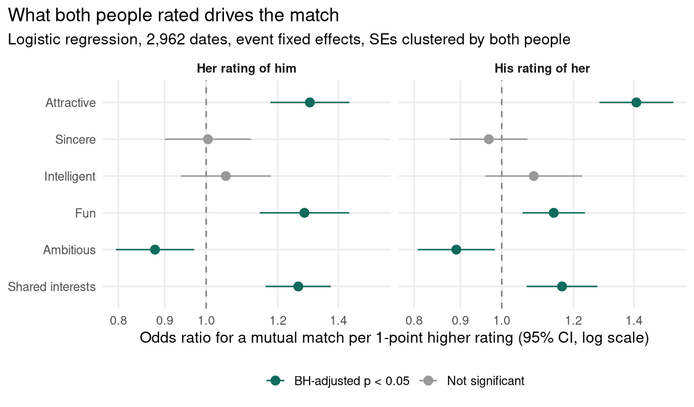
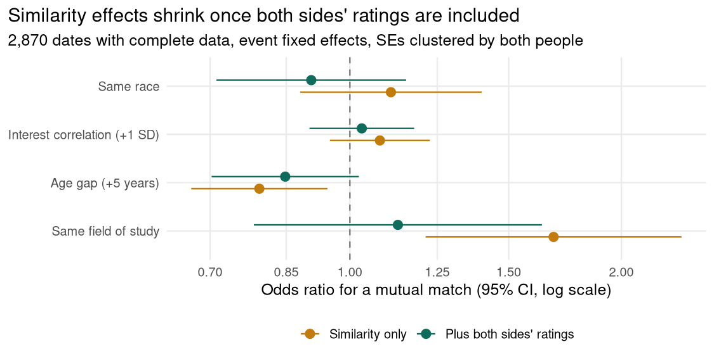
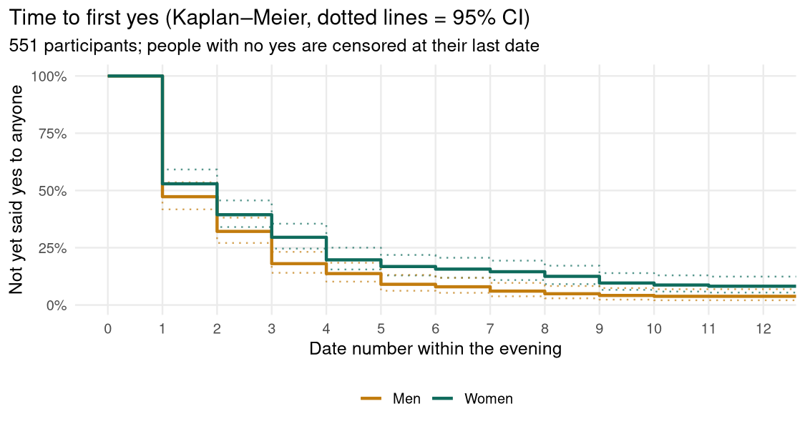
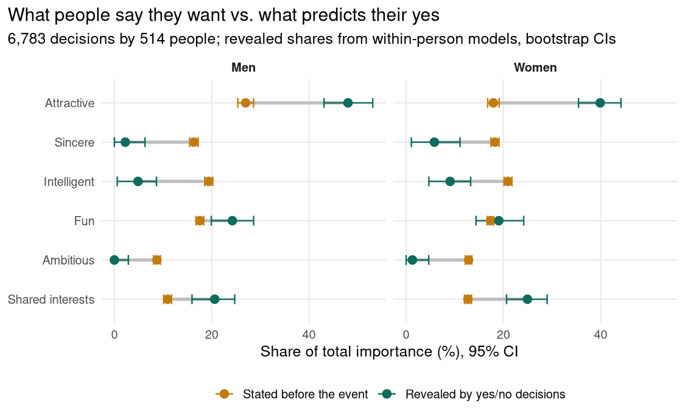

# What predicts a mutual match? Evidence from 8,378 speed dates

Fırat Durak · R analysis of the public Speed Dating Experiment data
(Fisman, Iyengar, Kamenica and Simonson, Columbia Business School,
2002–2004)

## Summary

In 21 speed-dating events, 551 people went on 4,184 four-minute dates
and, after each one, said yes or no to seeing that person again. A match
needed two yeses, and 16% of dates produced one. This analysis asks
which signals predict a mutual match, whether similar people match more
often, how decisions shift over the course of an evening, and whether
people choose the way they say they will. Attractiveness, fun and a
sense of shared interests drove matches on both sides. Similarity in age
and field of study went with more matches, but mostly through how the
two people rated each other. Women became slightly more selective as the
night went on. The largest gap was between stated and revealed
preferences. Participants said they valued intelligence and sincerity,
but their decisions were driven by attractiveness and shared interests.
Every model accounts for repeated decisions by the same person, through
clustered standard errors or within-person models, and
Benjamini–Hochberg (BH) correction is applied wherever several variables
are tested together. The code is in [`analysis.Rmd`](analysis.Rmd), and
this README is rendered from it.

## Key findings

### 1. A mutual match depends on attraction, fun and shared interests, rated by both people

Each extra point (on a 1–10 scale) in how attractive he found her raised
the odds of a mutual match by a factor of 1.41 (95% CI 1.28 to 1.55);
for how attractive she found him, the factor was 1.30 (95% CI 1.18 to
1.44). Fun and shared interests also mattered from both sides. Once
these were in the model, sincerity and intelligence ratings added
nothing, and ambition ratings had a small negative association. 8 of 12
coefficients survive BH correction.

<!-- -->

### 2. Similarity predicts little once you know how the date went

Two kinds of similarity went with more matches on their own. Each
additional 5 years of age gap lowered the odds of a match (OR 0.79, 95%
CI 0.67 to 0.94), and couples from the same field of study matched more
often (OR 1.68, 95% CI 1.21 to 2.33). Both effects shrank once the model
included how the two people rated each other. The age-gap estimate moved
to 0.85 (95% CI 0.70 to 1.02) and the same-field estimate to 1.13 (95%
CI 0.78 to 1.63), and neither survives BH correction. Similarity seems
to work mainly through how the conversation went, not as a separate
factor. Measured overlap in hobbies (OR 1.08, 95% CI 0.95 to 1.23 per
SD) and being of the same race (OR 1.11, 95% CI 0.88 to 1.40) showed no
clear effect in either model. The data give little support to
“similarity attracts” as an independent effect, and none to “opposites
attract”. These are behavioural and demographic proxies. This is not a
test of immune-gene (MHC) dissimilarity, which would need genetic data.

<!-- -->

### 3. Women grew slightly more selective as the evening went on; men did not

Treating each date of the night as a step in time gives a
retention-style curve, showing the share of participants who have not
yet said yes to anyone. The median participant said their first yes on
date 1 (men) and date 2 (women); after three dates, 18% of men and 30%
of women had still said no to everyone. Within the same person, each
later position in the evening multiplied a woman’s odds of saying yes by
0.983 (95% CI 0.969 to 0.997, BH-adjusted p = 0.033), about 16% lower
odds over ten dates. For men the estimate was 0.998 (95% CI 0.984 to
1.011), with no clear change. Partners rotate through the evening, so
the order of dates is close to random. This is the same Kaplan–Meier
method I would apply to time-to-first-reply or time-to-unmatch in app
conversation data.

<!-- -->

### 4. People say they value intelligence and sincerity, but they choose on attractiveness and shared interests

Before the event, participants divided 100 points among six attributes.
Their yes/no decisions tell a different story. Men gave attractiveness
27% of their stated weight, but it accounted for 48% (95% CI 43 to 53)
of what predicted their decisions; for women, the figures were 18%
stated and 40% (35 to 44) revealed. Women gave intelligence 21% of their
stated weight but only 9% (5 to 13) in practice. Shared interests went
the other way. They got little weight in advance (13% for women, 11% for
men) but strongly predicted decisions (25% and 21%). Stated weights were
also a weak guide to each person’s own choices. In 11 of 12 person-level
tests, the estimate pointed the expected way (more stated weight,
slightly more response to that attribute), but only 1 survives BH
correction (men’s weight on sincerity).

<!-- -->

## How this applies to a dating product

- **Rank on behaviour, not on stated preference settings.** Stated
  weights were a poor guide to what drove yes decisions overall, and
  only a weak guide to each person’s own choices. An A/B test could
  compare a ranking model trained on likes and replies with one that
  follows users’ stated filters, measured on mutual matches and
  conversations that pass a set length.
- **Help people find common ground early.** Feeling that you share
  interests predicted a match from both sides, while questionnaire
  overlap in hobbies did not. An A/B test could compare conversation
  prompts that surface shared values or plans with profile badges based
  on matching hobby lists, measured on reply rate and conversation
  length.
- **Treat queue position as a product variable.** Women’s yes rate fell
  slightly with each later date in an evening. An A/B test could vary
  where the strongest candidates appear in a daily batch, or cap batch
  size, and compare like rate and time-to-first-like curves (the
  Kaplan–Meier view in finding 3) between arms.

## Method notes and limitations

- **Data.** Each row is one person’s view of one date. Mutual-match and
  similarity models use one row per couple (4,184 dates); the ordering
  and preference models use one row per person per date. Ratings outside
  the 1–10 scale were set to missing. Analyses use complete cases, and
  shared-interest ratings are the most often missing (13% of rows).
- **Models.** Couple-level models are logistic regressions with event
  fixed effects and standard errors clustered on both people
  (`sandwich::vcovCL`). Ordering and revealed-preference models are
  conditional logistic regressions stratified by person
  (`survival::clogit`), so they compare each person’s decisions only
  with their own other decisions. Revealed weights use each person’s
  ratings standardised within that person; a revealed share is an
  attribute’s positive coefficient divided by the sum of positive
  coefficients, with 95% CIs from 500 bootstrap resamples of people.
  Stated weights were rescaled to sum to 100 for every person, since
  some events used a different scale. The person-level test adds an
  interaction between each standardised rating and that person’s stated
  weight for the attribute (per 10 points).
- **Ratings and decisions were recorded together.** People filled in
  ratings and their yes/no on the same scorecard, so a rating may partly
  justify a decision already made. The ratings also overlap (within a
  person, attractiveness and fun ratings correlate at r = 0.50), which
  makes individual coefficients less stable than the overall pattern.
  The negative ambition coefficients in finding 1 should be read in that
  light.
- **Who and what.** Participants were graduate students in New York in
  2002–2004, in heterosexual pairings, on four-minute in-person dates. A
  match here means both said yes at the event, not a lasting
  relationship. Results may not carry over to a marriage-focused app or
  to a Muslim user base; the methods do.
- **What the data cannot show.** There is no religion variable (only how
  important a same-religion partner is to each person), so religious
  similarity could not be tested. Nothing here is genetic, and none of
  it bears on MHC-based attraction.

## How to reproduce

Requires R (tested on 4.6.1) and pandoc.

``` bash
Rscript install.R    # dplyr, tidyr, purrr, ggplot2, survival, sandwich, knitr, rmarkdown
Rscript get_data.R   # downloads the CSV to data/raw/ and checks its SHA-256
Rscript -e 'rmarkdown::render("analysis.Rmd", output_file = "README.md")'
```

The raw data is not included because its license is not stated;
`get_data.R` downloads it from the copy hosted by Columbia University’s
statistics department. Source: R. Fisman, S. Iyengar, E. Kamenica and I.
Simonson (2006), “Gender Differences in Mate Selection: Evidence from a
Speed Dating Experiment”, *Quarterly Journal of Economics* 121(2),
673–697.

Package versions used: dplyr 1.2.1, tidyr 1.3.2, purrr 1.2.2, ggplot2
4.0.4, survival 3.8.6, sandwich 3.1.3, knitr 1.52, rmarkdown 2.32.
